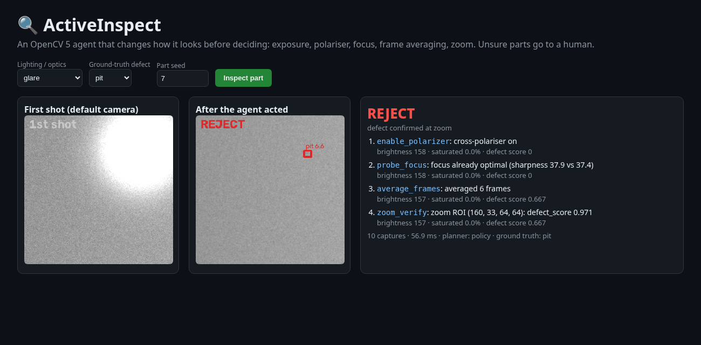
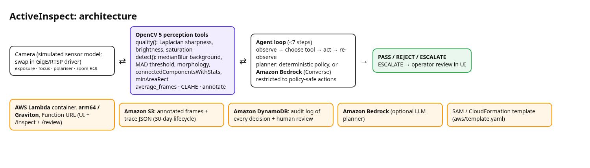

# 🔍 ActiveInspect: an OpenCV 5 inspection agent that changes how it looks

A single-shot inspection camera goes blind when the light dims, the part is out of focus, or glare hits a shiny surface, and then it **passes defective parts**. ActiveInspect measures image quality with OpenCV 5 and acts on the camera: exposure, cross-polariser, focus probe, frame averaging and zoom-to-verify. Then it decides PASS / REJECT, or **escalates to a human** when it still can't see well enough. It runs on **AWS Lambda (Graviton arm64) + S3 + DynamoDB**, with an optional **Amazon Bedrock** planner.



**Held-out eval (630 parts):** defect recall **9.8% → 90.7%**, escaped defects 379 → 8, zero false rejects, and 61 parts escalated instead of guessed. Full numbers and failure cases are in [REPORT.md](REPORT.md) and [eval/RESULTS.md](eval/RESULTS.md).



## Quick start (mock mode, no AWS needed)
```bash
python -m venv .venv && . .venv/bin/activate
pip install -r requirements.txt            # pins opencv-python-headless==5.0.0.93
PYTHONPATH=. pytest -q                     # 7 tests
PYTHONPATH=. python -m eval.run_eval 30    # ~40 s, writes eval/RESULTS.md + eval/failures/
PYTHONPATH=. uvicorn inspect_agent.server:app --port 8000
# http://localhost:8000/#c=glare&d=pit&s=7   (deep links: c=condition, d=defect, s=seed)
```

## Deploy to AWS
```bash
# needs AWS CLI v2, SAM CLI, Docker; region with Bedrock if you use it
BEDROCK_MODEL_ID=<optional model id> AWS_REGION=us-east-1 bash aws/deploy.sh
# prints the Function URL: open it for the same UI, live on Lambda arm64
```
| Env var | Purpose |
|---|---|
| `INSPECT_MOCK=1` | force the deterministic planner (default when `BEDROCK_MODEL_ID` is unset) |
| `BEDROCK_MODEL_ID`, `AWS_REGION` | LLM planner via the Bedrock Converse API |
| `RESULTS_BUCKET`, `AUDIT_TABLE` | set by SAM; S3 frames/traces and the DynamoDB audit log |

## Layout
`inspect_agent/camera.py` sensor simulator · `vision.py` OpenCV 5 tools · `agent.py` perception-decision-action loop · `service.py` AWS I/O · `lambda_handler.py` / `server.py` · `ui.html` · `aws/` SAM template, Dockerfile and deploy script · `eval/` benchmark.
